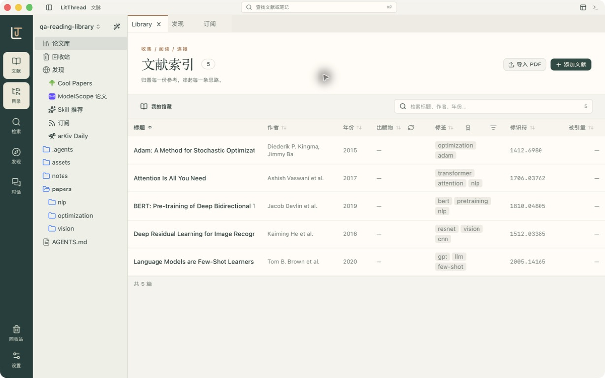

# LitThread · 文脉

一张本地研究书桌：收集文献，阅读与批注，记录笔记，围绕问题整理支持证据与反证，再带进研究对话。资料保存在自己的文件夹中，Markdown 笔记可被其他编辑器读取。



文脉由 React 界面、Tauri 原生应用和 Rust 命令行组成。桌面端承担文件访问、论文目录索引、PDF 处理与 Agent 运行；移动端通过配对连接桌面知识库。

英文名 `LitThread` 用于项目目录和应用文件名，中文名“文脉”用于界面与文档；包名和命令标识为 `litthread`。

参赛材料：[OS2026 作品介绍与演示视频](https://github.com/elsewhere-high/LitThread/releases/tag/os2026-20261013-final) · 开源 AI 工具赛道。

## 开始使用

开发需要 Node.js、pnpm、Rust stable、CMake 与平台原生编译工具。macOS 需要 Xcode 命令行工具；首次原生构建会下载 PDFium 并编译 OCR 依赖。依赖版本由 `pnpm-lock.yaml` 与 `Cargo.lock` 固定。

```sh
pnpm install --frozen-lockfile
pnpm tauri dev
```

`pnpm tauri dev` 会准备 PDFium、启动 Vite 和原生窗口。项目存在 `.toolchains/cargo` 时，本地脚本自动使用该 Rust 工具链，否则使用 PATH 中的 Rust。单独运行 `pnpm dev` 只能预览浏览器界面，本地知识库操作需要桌面应用。

首次打开后完成向导，建立或打开知识库。点击左侧“文献”进入索引，通过“导入 PDF”或“添加文献”收集材料；双击文献进入阅读，打开“对话”调用已配置的 Agent。

## 已有能力

| 环节 | 入口与行为 |
| --- | --- |
| 收集 | PDF 导入、标题/DOI/arXiv 查询、Zotero 迁移与 Connector、目录扫描 |
| 阅读 | PDF 与 Markdown、文本批注、阅读位置、引用与版面解析 |
| 记录 | Markdown 编辑、公式、Mermaid、双向链接、论文 `NOTES.md` |
| 论证 | 问题与假设、带页码的证据与反证、Markdown 研究笔记、手动准备 AI 审查 |
| 研究 | ACP Agent、上下文提及、技能、会话与权限确认 |
| 发现 | 订阅信息流、arXiv 推荐与第三方论文来源 |
| 携带 | 桌面远程访问、移动配对、SSH 知识库、可选同步 |
| 自动化 | 独立 CLI 的知识库、目录、文献与导出命令 |

模型、翻译、远程访问和同步均需要对应配置。默认不提供公共模型网关或远程中继；自动更新和在线 CLI 下载也未配置。基础文件整理、阅读与编辑可以本地进行。

## 构建与检查

```sh
pnpm typecheck
pnpm lint
pnpm test
pnpm test:rs
pnpm deps:check
pnpm build
pnpm cli:bundle
pnpm tauri build --debug --bundles app
```

最后一条是 macOS 本地调试应用包；发布构建使用 `pnpm tauri build`，签名、发布渠道和更新源由维护者另行配置。本地应用包在 `target/debug/bundle/macos/LitThread.app`，CLI 在 `target/debug/litthread-cli`。

## 进一步阅读

- [使用指南](docs/usage.md)：从第一份 PDF 到可追溯的笔记。
- [开发与验证](docs/development.md)：工具链、命令和检查边界。
- [结构与数据](docs/architecture.md)：源码分层与知识库契约。
- [命令行](docs/cli.md)：从源码目录外使用 CLI。
- [可选服务](docs/services.md)：端点、凭据与本地配置。
- [界面规范](docs/brand.md)：品牌资源和组件约定。
- [参赛准备](docs/competition.md)：演示流程、贡献边界与来源说明。
- [第三方技术与资源](docs/third-party.md)：关键依赖、来源注释与独立许可。

## 参与开发

欢迎通过本仓库的 Issues 提交可复现问题或需求，通过 Pull Request 提交改进。问题报告请注明系统、版本、操作步骤和预期结果，优先使用自编样本复现；不要上传真实知识库或凭据。提交代码前运行与改动有关的检查，界面文案同步英文和简体中文，并保留现有数据与权限契约。维护说明见 [开发与验证](docs/development.md)。

项目代码采用 [GNU AGPL 第 3 版](LICENSE)（`AGPL-3.0-only`，仅限第 3 版），版权署名为 © 2026 Ustinian5。随应用提供的部分研究技能带有独立第三方许可，见 [技能许可说明](templates/vault/.agents/skills/README.md)。应用资源目录的 `licenses/` 分别包含项目许可和研究技能的第三方声明。
